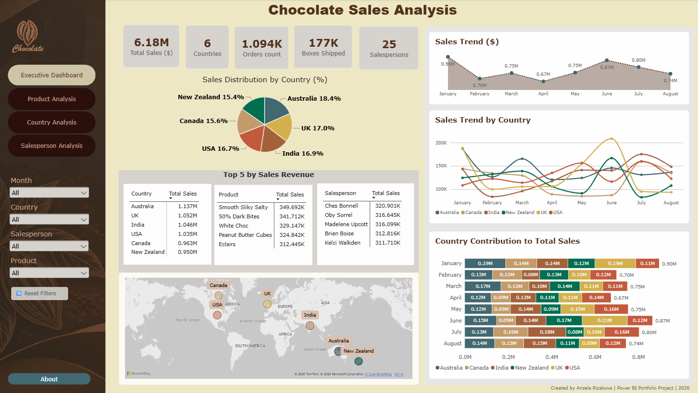
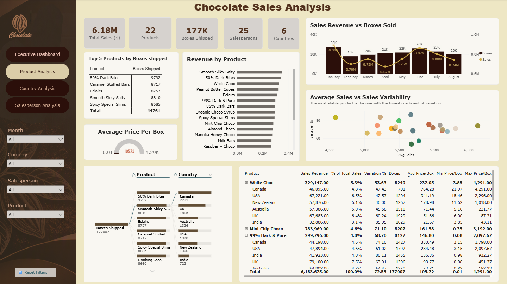
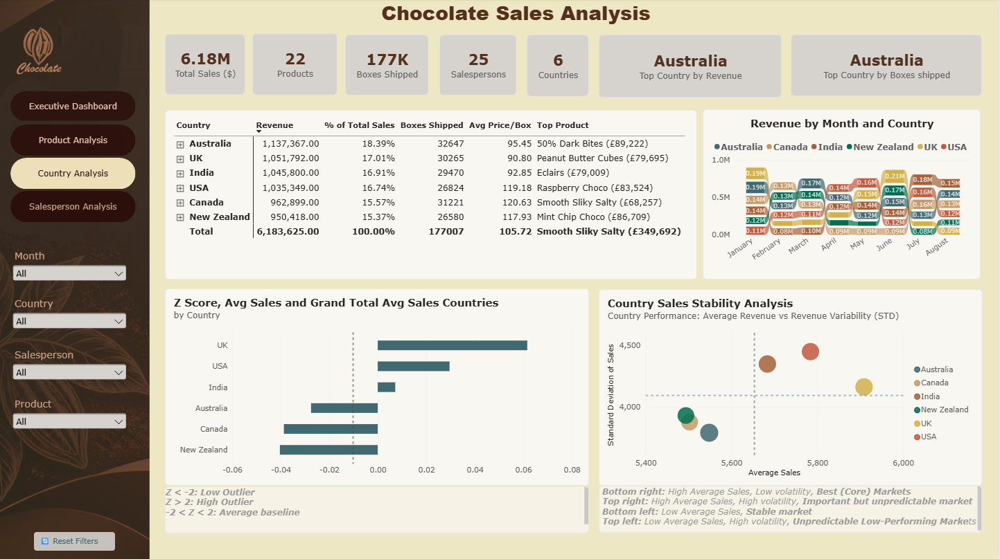
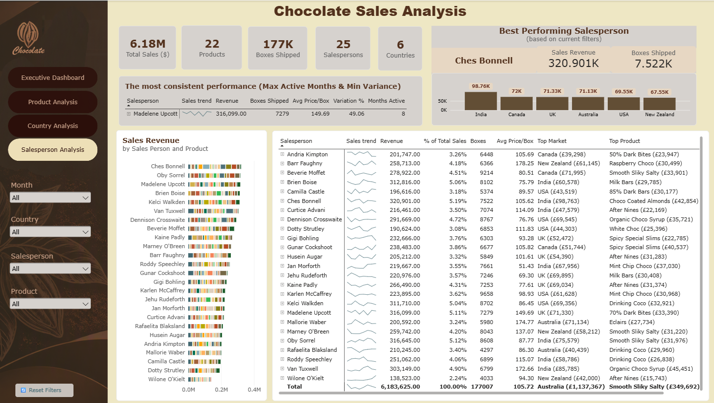

# 🍫 Chocolate Sales Dashboard

**Author:** Anzela Rizakova  
**Licence:** MIT

## Project Overview

An interactive Power BI dashboard analysing chocolate sales performance across products, countries, and salespeople from **January 2022 to August 2022**.

The project uses **Power BI**, **Power Query**, and **DAX** to explore revenue trends, sales volume, market performance, product contribution, and salesperson effectiveness through KPI indicators, statistical analysis, and interactive visualisations.

The analysis investigates chocolate sales performance using the **Chocolate_Sales** dataset, containing **1,094 records** across **7 attributes**:

- Date
- Salesperson
- Country
- Product
- Amount
- Boxes Shipped
- Price per Box

---

## What This Project Covers

- Data loading, cleaning and transformation using Power Query
- Data modelling and custom DAX measures
- Development of an interactive multi-page Power BI dashboard:
  - Executive Dashboard
  - Product Analysis
  - Country Analysis
  - Salesperson Analysis
- Product performance analysis by revenue, boxes sold, and average price per box
- Country-level sales analysis and market comparison
- Salesperson performance analysis
- Revenue contribution analysis for products, countries, and salespeople
- Sales trend analysis over time
- Statistical analysis using:
  - Standard Deviation
  - Coefficient of Variation (CV%)
  - Z-score Analysis
- Interactive visualisations including:
  - KPI Cards
  - Maps
  - Scatter Plots
  - Matrix Tables
  - Sparklines
  - Combo Charts
- Bookmark navigation and reset-filter functionality
- Business-focused insights and recommendations

---

## Repository Structure

```text
Assets/                                     # Screenshots and visual outputs from the analysis
│
├── page_01.png
├── page_02.png
├── page_03.png
├── page_04.png
└── navigating_panel_background_made_by_AI.png

Data/                    
└── Chocolate_Sales.csv                      # Original / raw version of the dataset

PBIX/
└── chocolate_sales_power_bi_project.pbix   # Power BI dashboard 

Docs/                                        # Project documentation and reports
├── Analysis_approach.md
└── Chocolate_sales_dashboard.pdf            # Power BI dashboard's pdf copy

LICENSE                                      # MIT License
README.md                                    # Project overview and documentation

```

---

## Dataset Information

| Column | Description |
|----------|------------|
| Date | January 2022 - August 2022 |
| Salesperson | Salesperson Name |
| Country | Country Name |
| Product | Product Name |
| Amount | Sales Revenue (£) |
| Boxes Shipped | Number of Boxes Shipped |

The dataset contains sales transactions for multiple chocolate products across different countries and salespeople.  
The dataset source:  Kaggle Dataset Link: https://www.kaggle.com/datasets/atharvasoundankar/chocolate-sales

---

# Key Findings

## Sales Trends

- Revenue peaked in January, driven by strong sales in the UK, New Zealand, and India. A notable decline followed in February, primarily due to reduced sales in these same markets.
- Revenue remained below the monthly average from February to May.
- April recorded the lowest revenue of the year. While India and the USA experienced sales growth, substantial declines across other markets led to an overall decrease in revenue.
- Revenue increased significantly in June and reached its highest level, largely due to higher sales in the UK and New Zealand.
- Revenue remained above the monthly average in July. Despite significant sales declines in the UK and New Zealand, robust growth across other markets supported overall revenue performance.
- Revenue fell below the monthly average in August due to declining sales across nearly all markets.

## Product Insights

- Smooth Silky Salty was the top-selling product during the reporting period.
- 70% Dark Bites generated the lowest sales revenue.
- Product demand was highly variable, with coefficients of variation ranging from 53% to 86%.
- White Choc exhibited the lowest sales variability (53%).
- Organic Choco Syrup showed the highest sales variability (86%).
- 85% Dark Bars became the top-selling product in the UK during June, contributing to the month's revenue peak despite being sold in the UK only during June and July.

## Pricing & Order Insights

- Revenue was influenced by both product pricing and shipment volume, as high-value orders were not always associated with large quantities.
- Price per box ranged from **£0.01** to **£4,291**, with an average of **£105.72**.
- Order sizes ranged from **1** to **709 boxes**, with an average of **162 boxes**, indicating a mix of small and bulk purchasing behaviour.

## Geographical Insights

- Although Australia generated the highest revenue, the narrow Z-score range (-0.04 to 0.06) indicates that overall sales performance remained relatively balanced across markets, with no extreme outliers.
- Australia, Canada, and New Zealand were the most consistent markets based on standard deviation analysis.
- India, the UK, and the USA contributed significantly to overall revenue but showed greater variability in performance.

## Salesperson Performance

- Revenue contributions were relatively balanced, with no individual contributing more than 5.19% of total revenue.
- Chess Bonnell generated the highest revenue contribution, accounting for 5.19% of total sales.
- Madelene Upcott delivered the most consistent performance, contributing 5.11% of total revenue and exhibiting the lowest sales variability.
- Wilone O'Kielt contributed 2.24% of total revenue, representing the lowest revenue contribution.

---

## Business Implications

- Revenue growth appears to be driven by specific products, markets, and time periods rather than consistent performance throughout the year.
- Volatile but high-performing markets such as the UK, USA, and India offer growth opportunities but require careful monitoring.
- Stable markets such as Australia, Canada, and New Zealand provide a reliable foundation for revenue generation.
- Significant variation in product demand highlights the importance of targeted inventory, pricing, and marketing strategies.

---

## How to Use the Dashboard

1. Download and install Power BI Desktop.
2. Clone the repository:
```Shell
git clone https://github.com/anzelary/chocolate_sales_Analysis_Power_BI.git
cd chocolate-sales-analysis
```
3. Open:

```text
PBIX/chocolate_sales_power_bi_project.pbix
```

4. If required, reconnect the dataset:

```text
Data/Chocolate_sales.csv
```

4. Refresh the model.
5. Explore the report pages using the interactive filters and slicers.

---

## Technologies Used

- **Power BI Desktop** - Dashboard development and reporting
- **Power Query** - Data extraction, transformation and loading (ETL)
- **DAX** - KPIs, calculated columns and measures
- **CSV Dataset** - Source sales data
- **Data Modelling** - Relationships and analytical calculations
- **Statistical Analysis** - Standard deviation, CV%, and Z-score analysis
- **Interactive Visualisations** - Trends, product analysis, country analysis and salesperson performance

---

## Visual Outputs

Dashboard screenshots can be found in the **Assets/** folder.  
A complete project report is available in:
```text
Docs/Chocolate_sales_dashboard.pdf
```
The detailed methodology can be found in:
```text
Docs/Analysis_approach.md
```

---

## License

This project is licensed under the [MIT License](LICENSE.md).

---

## Author

**Anzela Rizakova**
## Preview
## Dashboard page 

## Product analysis page

## Countries analysis page

## Salespersons analysis page


Created by Anzela Rizakova | Power BI Portfolio Project | 2026
