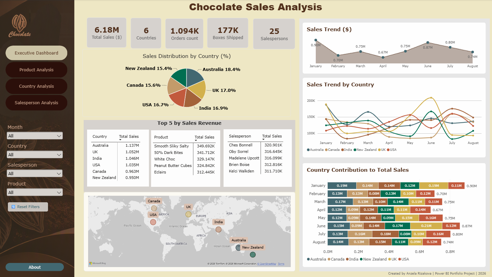
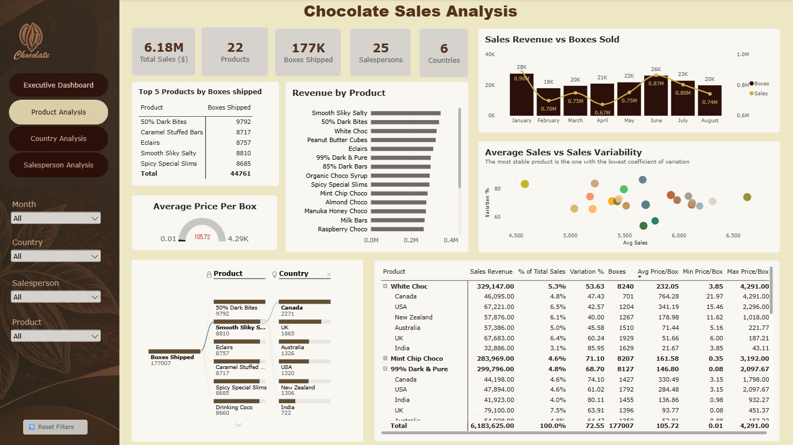
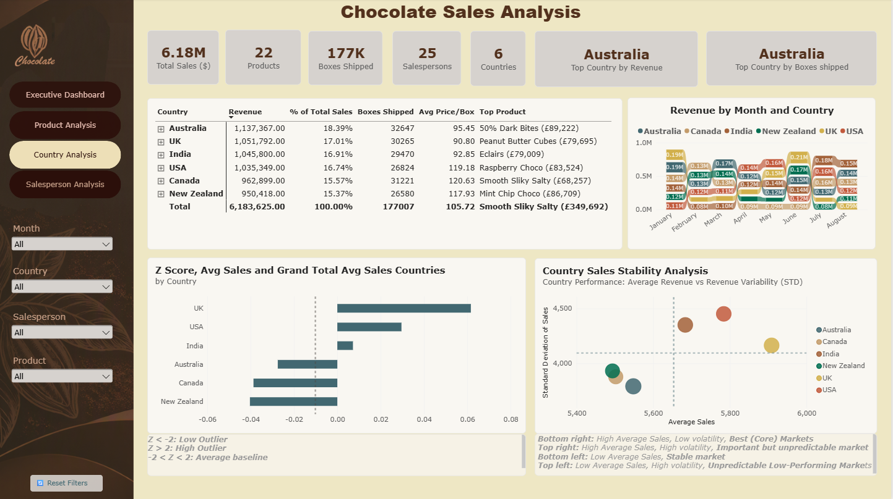
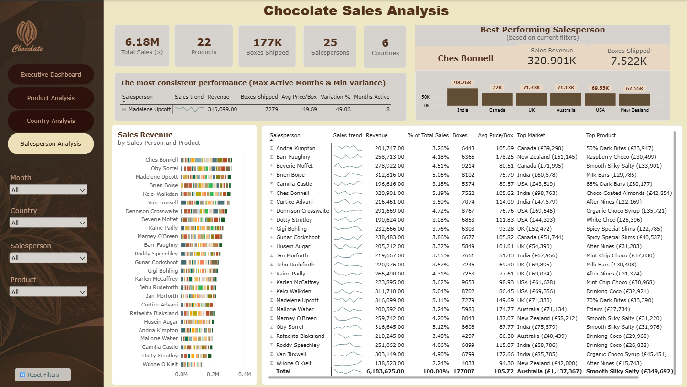

# Chocolate_Sales_Analysis_Power_BI

This dashboard analyses chocolate sales performance across products, countries and salespeople. The report enables users to identify top-performing products, key markets and sales trends.
The dataset source:  Kaggle Dataset Link: https://www.kaggle.com/datasets/atharvasoundankar/chocolate-sales

It includes KPI cards, charts, DAX measures, interactive visualisation and slicers

## Questions to answer
### Dashboard Page
What are total sales?
How many boxes were sold?
Which product generates the most revenue?
Which country generates the most revenue?
Who is the top salesperson?
How are sales trending over time?

### Product Analysis Page
Which products generate the highest revenue?
Which products sell the most boxes?
What percentage of total revenue comes from each product?
Which products are underperforming?
Are higher-priced products generating higher revenue?
Which products have the most stable sales?

### Country Analysis Page
Which countries generate the most revenue?
Which countries sell the most boxes?
Which countries contribute the largest share of revenue?
Which products perform best in each country?
Which countries have the highest average sales?
Which countries show the greatest volatility?
Which countries have the most predictable demand?
Which countries are outliers?

### Salesperson Analysis Page
Who is the top salesperson?
Which salesperson sells the most boxes?
Which salesperson generates the highest revenue?
Which country is each salesperson strongest in?
Which products does each salesperson sell best?
What is the average sale value per salesperson?
Which salesperson has the most consistent performance?

### Statistical Metrics
Minimum, Maximum, Average
Standard Deviation  - measure how much sales vary from the average
Coefficient of Variation (Variation % = Standard Deviation ÷ Average Sales ) - lower Variation % indicate more stable performance
Z score ((Average Sales - Grand Average Sales) ÷  Standard Deviation)  how many standard deviations a number is from the mean.

## Skills Demonstrated
- Power BI
- DAX
- KPI Development
- Statistical Analysis
- Interactive Visualisations

## Preview
## Dashboard page 

## Product analysis page

## Countries analysis page

## Salespersons analysis page

Created by Anzela Rizakova | Power BI Portfolio Project | 2026
